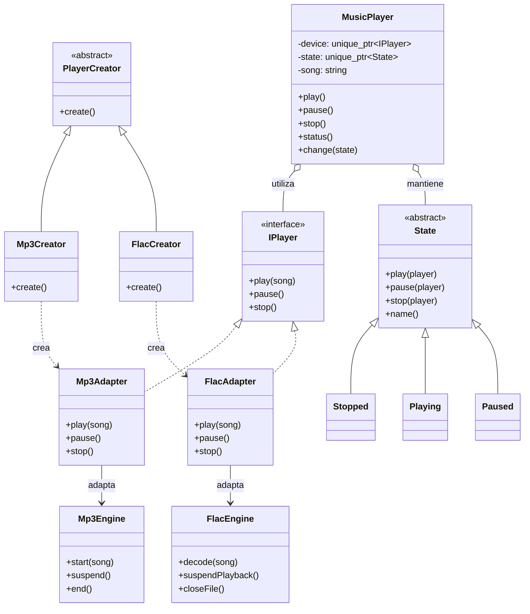

# MiniPlayer — Reproductor de música con patrones de diseño

## 1. Descripción del proyecto

**MiniPlayer** es una aplicación de consola desarrollada en C++ que simula un reproductor de música. Permite seleccionar una canción de una lista, reproducirla, pausarla, reanudarla y detenerla.

El proyecto fue creado como parte de un taller académico sobre patrones de diseño de software. Su propósito es demostrar cómo tres patrones de diferentes categorías pueden integrarse en un mismo flujo de ejecución para resolver problemas concretos de diseño.

**Problema que resuelve:** al desarrollar un reproductor compatible con diferentes formatos de audio, se necesita crear el reproductor adecuado, unificar las interfaces de los motores de reproducción y controlar las acciones permitidas según el estado actual.

## 2. Tecnologías utilizadas

- **Lenguaje:** C++.
- **Bibliotecas:** `iostream`, `memory`, `string` y `vector`.
- **Paradigma:** programación orientada a objetos.
- **Gestión de memoria:** punteros inteligentes (`unique_ptr`).
- **Compilación:** GCC mediante MinGW-w64 o MSYS2, compatible con Windows.

## 3. Patrones de diseño implementados

### 3.1. Creacional: Factory Method

**Problema:** el programa necesita crear un reproductor diferente según el formato de la canción seleccionada.

**Solución:** se utiliza una clase creadora abstracta, `PlayerCreator`, con dos implementaciones: `Mp3Creator` y `FlacCreator`.

**Clases principales:**

- `PlayerCreator`: define el método de creación.
- `Mp3Creator`: crea un `Mp3Adapter`.
- `FlacCreator`: crea un `FlacAdapter`.

**Beneficio:** la creación de los reproductores queda separada del flujo principal de la aplicación. Para incorporar otro formato, se pueden agregar nuevos creadores y adaptadores.

### 3.2. Estructural: Adapter

**Problema:** los motores MP3 y FLAC utilizan métodos diferentes para realizar operaciones equivalentes. Por ejemplo, MP3 utiliza `start()` y FLAC utiliza `decode()` para iniciar la reproducción.

**Solución:** los adaptadores `Mp3Adapter` y `FlacAdapter` implementan la interfaz común `IPlayer` y traducen sus operaciones a los métodos de cada motor.

**Clases principales:**

- `IPlayer`: define las operaciones `play()`, `pause()` y `stop()`.
- `Mp3Engine` y `FlacEngine`: representan los motores de cada formato.
- `Mp3Adapter` y `FlacAdapter`: adaptan los motores a la interfaz común.

**Beneficio:** el resto de la aplicación utiliza una misma interfaz sin depender de los métodos particulares de cada motor.

### 3.3. De comportamiento: State

**Problema:** las acciones del reproductor dependen de su estado. No debería comportarse igual cuando está detenido, reproduciendo o pausado.

**Solución:** el patrón State representa cada estado mediante una clase independiente que define cómo responder a las operaciones disponibles.

**Clases principales:**

- `State`: define las operaciones comunes de los estados.
- `Stopped`: representa el estado detenido.
- `Playing`: representa el estado de reproducción.
- `Paused`: representa el estado pausado.
- `MusicPlayer`: mantiene el estado actual y delega en él las operaciones.

**Beneficio:** cada estado controla las acciones válidas y las transiciones correspondientes, evitando concentrar todas las reglas en una única estructura de condiciones.

## 4. Integración de los tres patrones

Los tres patrones participan en el mismo flujo principal:

1. El usuario selecciona una canción y el programa identifica su formato.
2. **Factory Method** selecciona el creador adecuado y obtiene el adaptador correspondiente.
3. **Adapter** proporciona al reproductor una interfaz uniforme para controlar el motor seleccionado.
4. `MusicPlayer` recibe ese reproductor y comienza en el estado `Stopped`.
5. **State** controla las operaciones de reproducir, pausar y detener, delegando las acciones de audio al objeto `IPlayer`.
6. El programa muestra el estado actual y permite realizar nuevas operaciones.

La integración es importante porque cada patrón cumple una responsabilidad distinta dentro del mismo flujo. Factory Method crea el objeto, Adapter unifica su interfaz y State controla el comportamiento del reproductor.

Si se elimina Factory Method, la creación de los reproductores debe resolverse de otra manera. Sin Adapter, `MusicPlayer` tendría que conocer las interfaces específicas de cada motor. Sin State, las reglas y transiciones de los estados tendrían que gestionarse desde otra estructura centralizada.

## 5. Diagrama de relaciones entre las clases



## 6. Estructura del proyecto

```text
R_Music_SP/
├── musicr.cpp
└── README.md
```

- `musicr.cpp`: contiene la implementación de la aplicación y los tres patrones.
- `README.md`: documenta el objetivo, las clases, la integración y las instrucciones de ejecución.

## 7. Requisitos e instrucciones de ejecución

Se necesita un compilador de C++ compatible con C++14 o superior y Git para publicar el proyecto.

### Compilar en Windows

Abre PowerShell dentro de la carpeta del proyecto:

```powershell
cd "C:\Users\Luis\Desktop\Projects\R_Music_SP"
```

Comprueba que GCC esté disponible:

```powershell
g++ --version
```

Compila la aplicación:

```powershell
g++ -std=c++14 -Wall -Wextra musicr.cpp -o musicr.exe
```

Ejecuta el programa:

```powershell
.\musicr.exe
```

Si el comando `g++` no se reconoce, instala o configura un compilador como MinGW-w64 o MSYS2 y verifica que su carpeta `bin` esté incluida en la variable de entorno `PATH`.

## 8. Ejemplo de ejecución

Una ejecución posible consiste en seleccionar la canción en formato FLAC y probar sus operaciones:

```text
=== MINIPLAYER ===
1. Blinding Lights - The Weeknd [MP3]
2. Bohemian Rhapsody - Queen [FLAC]
3. Viva La Vida - Coldplay [MP3]
Selecciona una cancion (0 para salir): 2
Formato: FLAC

Estado: DETENIDO
1. Reproducir/reanudar
2. Pausar
3. Detener
0. Salir
Opcion: 1
[FLAC] Reproduciendo: Bohemian Rhapsody

Estado: REPRODUCIENDO
1. Reproducir/reanudar
2. Pausar
3. Detener
0. Salir
Opcion: 2
[FLAC] Pausado

Estado: PAUSADO
1. Reproducir/reanudar
2. Pausar
3. Detener
0. Salir
Opcion: 3
[FLAC] Detenido
```

_Nota: la salida es ilustrativa. El programa muestra mensajes simulados; no reproduce archivos de audio reales._

## 9. Integrantes del grupo

- Integrante 1: Luis Alfonso Cardona Castillo
- Integrante 2: [Nombre completo]
- Integrante 3: [Nombre completo]
- Integrante 4: [Nombre completo, si aplica]

## 10. Fuente de consulta

Refactoring.Guru. Catálogo de patrones de diseño:

https://refactoring.guru/design-patterns/catalog

Patrones utilizados:

- Factory Method: https://refactoring.guru/design-patterns/factory-method
- Adapter: https://refactoring.guru/design-patterns/adapter
- State: https://refactoring.guru/design-patterns/state

---

**Proyecto académico:** Taller de patrones de diseño integrados en una aplicación corta y video estilo Short.
